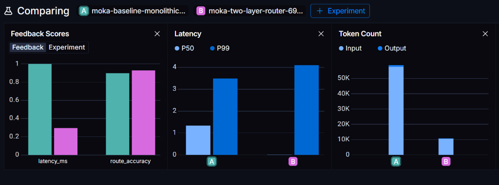

# MoKa AI Assistant

An AI-powered assistant built around the **Anki Cozmo** robot. The system uses a state-of-the-art two-layer intelligence pipeline: **Layer 1** fast semantic reflexes (~50ms latency) for instant physical and laptop commands, and **Layer 2** a dynamic **LangGraph-powered AI brain** (`backend/core/routing/layer2`) backed by PostgreSQL persistent memory, FAISS dynamic tool RAG, and sub-35ms neural route selection via the resident **LAYA Typed Decision Model** for natural conversation, Google Calendar management, code execution, and autonomous task agents. All features are exposed via an interactive console launcher, voice control, or a **FastAPI** REST bridge.

---

## Features

| Feature | Description |
|---|---|
| **Interactive Launcher** | Unified `main.py` console with a menu to run Terminal Mode (repl with brain) or Cozmo Mode (robot + API server) |
| **Voice Input** | Wake-word listener (`"hey buddy"`) captures mic audio, transcribes via Google Speech Recognition, and routes to Layer 1 reflexes or LangGraph |
| **Text-to-Speech** | Zero-disk I/O local TTS using **Kokoro-ONNX** for near-studio quality human expressions, offloaded to async background threads (implementation inspired by OpenJarvis) |
| **Layer 1 Semantic Router** | Instant intent matching (~50ms) using `semantic-router` + `FastEmbed` for latency-critical commands (bypasses LLM) |
| **Reflex Safety Guards** | Real-time hardware safety system in `safety.py` providing anti-fall (cliff/freefall detection + autonomous U-turn backup) and anti-dump/stall protection (IMU pitch tilt, impact shock, pose tracking, and OpenCV visual motion stasis) |
| **Dynamic Layer 2 Tool RAG** | Rather than bloating LLM prompts with static definitions, tools are indexed in an in-memory vector database (**FAISS** + `BAAI/bge-small-en-v1.5` embeddings) and dynamically injected into the router's context based on relevance |
| **Dynamic MCP Ingestion (FR-C05)** | Runtime discovery and live vector indexing of tools from external **Model Context Protocol (MCP)** servers without application restarts. Supports automated tool description synthesis and instant FAISS injection |
| **Human-in-the-Loop Confirmation (FR-C03)** | Safe execution gate for state-mutating actions (e.g. file mutations, destructive database writes, non-read-only MCP tools). Halts execution with an `hitl_interrupt` event and awaits explicit user approval in the Web UI |
| **MCP Tools Drawer & Catalog** | Interactive frontend drawer enabling real-time inspection, one-click connection/disconnection of MCP servers, parameter inspection, and automated discovery of dormant capabilities |
| **Tavily MCP Integration** | Executes highly optimized, real-time web searches using the official Tavily **Model Context Protocol (MCP)** server spawned via standard `npx` stdio client pipes |
| **Local Laptop Automation Setups** | Instant laptop routines for **Gaming Mode** (launches Steam, CS2, Discord), **Study Mode** (opens Moodle, Gemini, NotebookLM), and **Coding Mode** (opens PyCharm, GitHub, Gemini) |
| **Specialized Weather Agent** | A ReAct agent that queries the `wttr.in` API to provide real-time, conversational weather updates |
| **Google Calendar Integration** | Multi-step calendar manager that queries, creates, moves, or deletes appointments using an **n8n** webhook connected to Gemini API |
| **Autonomous Docking** | Visual color-based navigation — Cozmo activates his camera, scans for the charger's yellow-green marker (RGB 204, 255, 51) using HSV color filtering, steers toward it, and backs onto the charging pins |
| **Face Expressions** | Dynamic rendering of graphics, countdown timers, and weather info directly onto Cozmo's 128×64 OLED face display |
| **Timer** | Runs asynchronous countdown timers with real-time MM:SS face updates |
| **FastAPI REST Bridge** | Exposes all physical actions (docking, speak, timer, face expressions) as HTTP endpoints for external triggers |
| **Short-Term Memory** | PostgreSQL-backed persistent session state tracker (`PostgresSaver` via `psycopg_pool.ConnectionPool` with auto-reconnect) paired with rolling context summarization and automatic history trimming |
| **Long-Term Memory** | Production-grade persistent profile powered by **Mem0** and PostgreSQL **`pgvector`** (Neon), FastEmbed ONNX embeddings (`BAAI/bge-small-en-v1.5`), intelligent contradiction reconciliation (UPDATE/DELETE/ADD), and two-way Markdown file sync (`backend/data/user_profile.md`) |
| **Code Executor Agent** | Deterministic local code execution sub-agent that spawns an isolated Python sandbox to run calculations, algorithms, data filtering, and text parsing with absolute accuracy (using `ornith:9b` via local Ollama) |

---

## Architecture

```
                                  User Input (Terminal / Voice / Web)
                                                   │
                                                   ▼
                       ┌────────────────────────────────────────────────────────┐
                       │                Layer 1 Semantic Router                 │  ← Fast Embeddings (~50ms)
                       │         (core/routing/layer1 + FastEmbed)              │    Bypasses LLM entirely.
                       └───────────────────────────┬────────────────────────────┘
                                                   │ No reflex match
                                                   ▼
                       ┌────────────────────────────────────────────────────────┐
                       │        Layer 2: LangGraph Brain (Cognitive Pipeline)   │
                       │               (backend/core/routing/layer2)            │
                       │                                                        │
                       │  ┌──────────────────────────────────────────────────┐  │
                       │  │ 1. Memory Retrieval Node (Postgres Vector Core)  │  │  ← Injects user profile & facts
                       │  └────────────────────────┬─────────────────────────┘  │
                       │                           ▼                            │
                       │  ┌──────────────────────────────────────────────────┐  │
                       │  │ 2. Tool Retrieval Node (FAISS + FastEmbed RAG)   │  │  ← Top 3 candidate tool schemas
                       │  └────────────────────────┬─────────────────────────┘  │
                       │                           ▼                            │
                       │  ┌──────────────────────────────────────────────────┐  │
                       │  │ 3. Route Query Node (LAYA Typed Decision Model)  │  │  ← Single-pass classifier (~33ms)
                       │  └────────────────────────┬─────────────────────────┘  │
                       │                           │ next_route (key)           │
                       │             ┌─────────────┴─────────────┐              │
                       │      Tool matched                  No tool / "none"    │
                       │             ▼                           ▼              │
                       │  ┌────────────────────┐   ┌─────────────────────────┐  │
                       │  │ 4a. Tool Executor  │   │ 4b. Chat Companion Node │  │  ← Unified TOOL_REGISTRY vs.
                       │  │  (execute_tool)    │   │       (chat_node)       │  │    Contextual Chat with Memory
                       │  └──────────┬─────────┘   └─────────────┬───────────┘  │
                       │             └─────────────┬─────────────┘              │
                       │                           ▼                            │
                       │  ┌──────────────────────────────────────────────────┐  │
                       │  │ 5. Rolling Summarizer (PostgresSaver Pruning)    │  │  ← Condenses history (>6 msgs)
                       │  └────────────────────────┬─────────────────────────┘  │
                       │                           ▼                            │
                       │  ┌──────────────────────────────────────────────────┐  │
                       │  │ 6. Memory Extraction Node (Async Background)     │  │  ← Saves biographical traits
                       │  └────────────────────────┬─────────────────────────┘  │
                       └───────────────────────────┼────────────────────────────┘
                                                   ▼
                                                  END
```

### 1. Layer 1 Semantic Router (Fast Reflexes)
Embedding-based semantic lookup. Utterances are mapped to a local registry of python operations (`core/routing/layer1/registry.py`) enabling instantaneous response for:
*   Physical actions: Autonomous charger docking.
*   System operations: Date, time, and laptop configurations (Gaming/Coding/Study setups).

### 2. Hardware Reflex Safety Guards (`backend/core/hardware/safety.py`)
Operating directly inside PyCozmo's low-level packet thread context (~33Hz), `ReflexSafetyGuard` provides zero-latency hardware protection by intercepting motor control methods (`drive_wheels`, `drive_straight`, `turn_in_place`, `stop_all_motors`) whenever dangerous conditions occur:
*   **Anti-Fall Guard (Cliff & Freefall Protection)**:
    *   **Goal**: Ensures Cozmo will not fall off tables, desks, or elevated boundaries.
    *   **Implementation**: Listens directly to low-level `CLIFF_DETECTED` and `IS_FALLING` hardware status flags. When triggered, it instantly sets `safety_tripped` to block incoming host movement commands, emergency stops all motors, and spawns a background thread executing a non-blocking evasive maneuver (reversing away from the edge for 1.2s, pausing, and performing a 1.5s 180° U-turn away from the boundary).
*   **Anti-Dump & Anti-Stall Guard (Obstacle Collision Protection)**:
    *   **Goal**: Prevents Cozmo from pushing mindlessly into obstacles, stalling motors, tilting over, or dumping objects/himself when driving forward.
    *   **Implementation**: Evaluates 3 multi-modal detection signals during forward movement:
        1.  **IMU Pitch Tilt**: Detects pitch angle spikes (`> 0.35 rad` / `~20°` tilt) caused by climbing objects or tipping upward (preventing dumping/flipping).
        2.  **Impact Deceleration**: Measures true forward X-axis deceleration ($a_x - g \sin\theta \le -3500\text{ mm/s}^2$) to catch sharp physical collisions.
        3.  **Pose & OpenCV Visual Motion Stasis**: Combines a 0.8s pose sliding window ($< 10\text{mm}$ moved) with a 1.0s sliding OpenCV frame difference (`cv2.absdiff` on downscaled, blurred camera frames with mean diff $< 3.5$). If the camera scene remains static while wheels are commanded forward, visual stasis/collision is detected, safety trips, motors halt, and Cozmo backs away (1.0s) from the obstacle.

### 3. Layer 2 LangGraph Brain (`backend/core/routing/layer2`)
For complex, multi-turn, and knowledge-driven requests, the system transitions to a modular stateful LangGraph pipeline (`router.py`) orchestrated with dynamic tool retrieval, ultrafast neural routing via **LAYA**, and end-to-end memory integration:

1.  **Memory Retrieval Node (`memory_retrieval_node`)**:
    *   Queries the native PostgreSQL Long-Term Memory Core (`long_term_memory`) using dense vector similarity (`BAAI/bge-small-en-v1.5` embeddings via `FastEmbed`).
    *   Retrieves the top-3 relevant user biographical facts, or returns full biographical profiles on meta-queries (*"what facts do you know about me"*, *"tell me about myself"*), injecting them directly into state (`retrieved_memories`).
2.  **Tool Retrieval Node (`tool_vector_db.py` / `tool_retrieval_node`)**:
    *   Maintains an in-memory vector database (`ToolVectorRegistry`) powered by **FAISS** `IndexFlatIP` and `FastEmbed`.
    *   Dynamically embeds and indexes registered tool schemas, querying the user's latest statement to retrieve only the **top-3 most relevant candidate tools**. This eliminates prompt bloat and prevents tool confusion on small local models.
    *   **Live Dynamic MCP Ingestion**: External tools discovered from Model Context Protocol servers are dynamically injected into the live FAISS index via `register_and_index_tool()` in real time with zero server restarts.
3.  **Neural Route Query via LAYA (`route_query`)**:
    *   Instead of relying on slow, unconstrained LLM token generation, route selection is performed by the resident **LAYA Typed Decision Model** (`convaiinnovations/laya-typed-decisions`).
    *   Formulates a structured typed-choice decision question comparing the retrieved candidate tools against clear criteria. LAYA evaluates the options in a single forward pass (**~33ms latency**), selecting the winning tool route key or cleanly returning `"none"`.
4.  **Dynamic Decision Routing (`decide_next_step`) & HITL Safety Gate**:
    *   Evaluates the route decision via conditional edge branching:
        *   **Human-In-The-Loop Safety Gate (`hitl_interrupt`)**: If the selected action is state-mutating (e.g. destructive database updates, file writing, non-read-only MCP tools), execution pauses with an interrupt event sent to the client, requiring explicit approval from the Web UI before proceeding.
        *   **Unified Tool Executor (`execute_tool_node`)**: Resolves the selected route key against a centralized Python `TOOL_REGISTRY` (`worker_nodes.py`), scaling to 100+ tools with zero graph recompilation. Dispatches to:
            *   **Calendar Agent (`calendar_node`)**: Multi-step LangGraph ReAct agent managing Google Calendar schedules and appointments.
            *   **Web Search Node (`web_search_node`)**: Real-time web retrieval via n8n integration.
            *   **Weather Node (`weather_node`)**: High-speed regex city extraction, `wttr.in` lookup, live Cozmo OLED face rendering (weather condition & temperature display loop), and spoken summary.
            *   **Code Executor Sub-Agent (`code_executor_node`)**: Deterministic local Python sandbox execution for mathematical calculations and string operations via `ornith:9b`.
            *   **To-Do List Agent (`todolist_node`)**: Task and checklist tracking agent.
            *   **Movement & System Fallbacks**: Physical motor commands (`move_forward`, `turn_left`, `dock_with_charger`, `arc_sweep`) and workstation presets (`setup_gaming`, `setup_study`, `setup_coding`, `tell_time`, `get_date`).
        *   **Chat Companion Node (`chat_node`)**: Formulates natural, conversational responses using local (`qwen2.5:3b` via Ollama) or cloud models (Azure `Phi-4-mini`), guided by conversational hygiene rules, running session summaries, and injected biographical facts.
5.  **Rolling Summarization Node (`summarize_conversation_node`)**:
    *   Triggers when a conversation session exceeds 6 messages.
    *   Condenses older exchanges into a running summary string in state while emitting `RemoveMessage` instructions to prune active messages from PostgreSQL session state (`PostgresSaver`), maintaining small context windows and fast inference.
6.  **Asynchronous Memory Extraction Node (`memory_extraction_node`)**:
    *   Runs on a non-blocking background thread (`threading.Thread(daemon=False)`) at the conclusion of every response.
    *   A zero-temperature LLM scans recent dialogue turns, strictly filters transient data (weather, times, dates), and extracts permanent user biographical facts (name, occupation, location, preferences) formatted as `Fact | Category_Key`. Facts are persisted into PostgreSQL using $O(1)$ category resolution or cosine deduplication.

### 4. Layer 2 Memory Architecture (Short & Long-Term)
The assistant features a sophisticated, persistent two-tiered memory architecture designed to run efficiently on local systems without heavy cloud or complex database dependencies:

#### A. Short-Term Memory (Stateful Session Checkpointing)
*   **PostgreSQL Session Checkpointer**: Driven by LangGraph's `PostgresSaver` backed by a resilient `psycopg_pool.ConnectionPool` (`check=ConnectionPool.check_connection`, `max_idle=300`). Conversational sessions are stored statefully across restarts, automatically surviving serverless database idle timeouts (Neon scale-to-zero) with zero dropped connections.
*   **Automatic Database Migrations**: Self-heals and sets up all required system schemas and state tables natively on application initialization (`checkpointer.setup()`), gracefully falling back to local memory if PostgreSQL is offline.
*   **Rolling Summarization Node**: To prevent local LLM context window bloating and maintain fast inference speeds:
    *   If a session accumulates **more than 6 messages**, the graph triggers `summarize_conversation_node`.
    *   It condenses historical context into a concise running `summary` attribute inside the state.
    *   It emits a sequence of `RemoveMessage` commands to prune active messages older than the last 4 exchanges (2 full turns), freeing up significant CPU resources while maintaining context.

#### B. Long-Term Memory (Permanent Semantic Profile Core)
*   **PostgreSQL `pgvector` Store via Mem0**: Powered by **Mem0** with a high-concurrency vector store on Neon PostgreSQL (`collection_name="moka_user_memories"`). Bypasses local file-locking bottlenecks, enabling simultaneous access from the web server, background workers, and evaluation tests.
*   **100% Local ONNX Embeddings**: Generates 384-dimensional dense vectors locally using `FastEmbed` (`BAAI/bge-small-en-v1.5`), ensuring fast, privacy-preserving embedding generation.
*   **Intelligent Memory Reconciliation Engine**:
    *   Rather than blindly appending contradictory facts, Cozmo runs an intelligent few-shot reconciliation pass (`_reconcile_dialogue`) on incoming conversation against existing memories.
    *   **In-Place Update (`UPDATE`)**: When user identity or preferences change (e.g., *"my name is not Michael, it's Mohammad"*), the engine updates the existing vector and memory text directly.
    *   **Explicit Forgetting (`DELETE`)**: When the user asks to forget or negate a fact (e.g., *"forget that I study robotics"*), the engine permanently removes the record from `pgvector`.
    *   **Incremental Additions (`ADD`)**: Captures new biographical traits (field of study, hobbies, tools) without duplicating existing knowledge.
*   **Two-Way Markdown Profile Sync (`user_profile.md`)**:
    *   Live profile memories are automatically exported to human-readable Markdown at [`backend/data/user_profile.md`](file:///c:/Users/mkrad/PycharmProjects/moka_ai_assistant/backend/data/user_profile.md).
    *   Users can directly inspect, edit, delete lines, or add new facts using any text editor or Obsidian.
    *   Run `python backend/sync_memory.py` to synchronize manual markdown edits directly into `pgvector`.
*   **Asynchronous Background Extraction**:
    *   Memory extraction executes on a non-blocking background thread (`threading.Thread(daemon=False)`) at the end of each response, keeping physical text-to-speech (TTS) and voice response cycles entirely lag-free.
*   **Semantic Memory Retrieval**:
    *   Matches current query embeddings against stored facts to fetch up to 3 highly relevant personal details per turn, feeding them silently to Cozmo's system context. Special meta-queries (*"what do you know about me?"*) automatically retrieve full profile summaries.
### 5. Benchmark Evaluation: Two-Tier Architecture vs. Monolithic Baseline

To rigorously evaluate the advantage of MoKa's **Two-Tier Fallback Hierarchy & Dynamic Tool RAG** against the standard industry approach of a single monolithic all-tools prompt, we ran a comprehensive 57-case benchmark evaluated via **LangSmith**:



#### Key Performance Comparison

| Metric | Monolithic Baseline Router (All-Tools) | MoKa Two-Tier Router (Reflex + Tool RAG) | Advantage |
|---|---|---|---|
| **Routing Accuracy** | `89.5%` (51/57) | **`93.0%` (53/57)** | **+3.5% Accuracy** (Avoids tool confusion) |
| **P50 Latency (Median)** | `~1,340 ms` (`1.34s`) | **`~45 ms` (`0.045s`)** | **~30x Faster** (Direct reflex path) |
| **Total Input Tokens** | `~59,200` tokens | **`~10,150` tokens** | **~83% Token Reduction** (Compact context) |
| **Physical Command Safety** | Dangerous ~2s delay on movement | **Instant ~50ms emergency reaction** | Critical robot safety |
| **Conversational Nuance** | Single chance to classify | **Layer 1 fast path + Layer 2 safety net** | Zero blind spots |

#### Why the Two-Tier System Outperforms in Every Aspect:
1. **Elimination of Tool Crowding & Prompt Confusion**:
   - In a monolithic prompt with 19+ tools, small local models (`qwen2.5:3b`) suffer from attention dilution—regularly confusing `weather_node` with `web_search_node`, or attempting to calculate math directly in chat rather than delegating to `code_executor_node`.
   - MoKa's **Layer 2 Tool RAG** retrieves only the top 2–3 relevant candidate schemas using FAISS vector similarity, keeping LLM attention razor-sharp.
2. **Spinal Reflex Arc for Critical Hardware Control**:
   - Robotic commands (*"stop"*, *"turn left"*, *"dock yourself"*) require instantaneous response. Tier 1 executes in **~45ms** directly via `FastEmbed` cosine similarity without waiting for LLM token generation.
3. **Graceful Cognitive Safety Net**:
   - If a user uses creative, conversational phrasing that misses Layer 1 (*"time to recharge your battery"*, *"I want to hop on CS2 with the boys"*), the query is not dropped—Layer 2's vector index catches the intent and routes it accurately.

---

## Project Structure

The project has a highly modular architecture separating physical controls, digital integrations, state schemas, and core routing logic:

```
cozmo_ai_assistant/
│
├── main.py                     # Entry point launcher (Terminal Mode / Cozmo Mode menu)
├── Launch_Cozmo.bat            # Windows startup script to execute Terminal Mode
├── roadmap.md                  # Project milestones and task backlog
├── README.md                   # Full system documentation
│
└── backend/                    # Core Python backend package
    ├── core/
    │   ├── __init__.py
    │   │
    │   ├── hardware/               # Physical hardware connections and robot managers
    │   │   ├── __init__.py
    │   │   ├── connection.py       # Singleton Cozmo hardware connection manager
    │   │   └── safety.py           # Real-time ReflexSafetyGuard (Anti-fall & Anti-dump/stall protection)
    │   │
    │   ├── routing/                # AI Intelligence: Union Brain, Layer 1 & Layer 2 routing pipelines
    │   │   ├── __init__.py
    │   │   ├── brain.py            # Unified Brain coordinator & SSE telemetry streaming engine
    │   │   ├── encoder.py          # Shared vector embedding utilities
    │   │   ├── llm_factory.py      # Dynamic LLM provider factory (Ollama local / Azure cloud / Groq)
    │   │   ├── laya_router_service.py # Resident LAYA Typed Decision Model microservice (~33ms)
    │   │   │
    │   │   ├── layer1/             # Layer 1 Deterministic Semantic Reflexes (~50ms)
    │   │   │   ├── __init__.py
    │   │   │   ├── registry.py     # Decorator class for low-latency reflex registration
    │   │   │   └── semantic_layer.py # Semantic matching router & package-wide action loader
    │   │   │
    │   │   └── layer2/             # Layer 2 Cognitive StateGraph & Dynamic Tool Architecture
    │   │       ├── __init__.py
    │   │       ├── router.py       # LangGraph StateGraph builder, PostgresSaver session checkpointer
    │   │       ├── graph_nodes.py  # Flow nodes: Memory retrieval, Tool RAG, LAYA route_query, Summarizer, Fact extraction
    │   │       ├── worker_nodes.py # Unified TOOL_REGISTRY worker handlers (Calendar, Weather, Search, Code, ToDo, Robot fallbacks, Chat)
    │   │       └── tool_vector_db.py # FAISS vector index bridge for dynamic tool registration & retrieval
    │   │
    │   └── modes/                  # Interface modes and runtime application shells
    │       ├── __init__.py
    │       ├── cozmo_mode.py       # FastAPI application server and REST endpoint routing
    │       └── terminal_mode.py    # Terminal REPL chat client with n8n/Ollama auto-initialization
    │
    ├── actions/
    │   ├── physical/               # Robot hardware controls
    │   │   ├── __init__.py
    │   │   ├── charger.py          # Vision-guided docking using OpenCV HSV color filtering (Yellow-Green, RGB 204, 255, 51)
    │   │   ├── face.py             # OLED canvas draw actions (Timer MM:SS, weather details, thinking indicator)
    │   │   ├── listen.py           # Speech recognition wake-word parser ("hey buddy") (implementation inspired by OpenJarvis)
    │   │   ├── speak.py            # Kokoro-ONNX zero-disk I/O local TTS engine (implementation inspired by OpenJarvis)
    │   │   └── timer.py            # Asynchronous countdown clock controller
    │   │
    │   └── digital/                # Digital APIs & Agent integrations
    │       ├── __init__.py
    │       ├── langchain/          # LangChain cognitive tools
    │       │   ├── code_executor.py # Local Python code sandbox execution sub-agent using ornith:9b
    │       │   └── weather_agent.py # Weather agent utilizing wttr.in tool & prompt formatting
    │       ├── langgraph/          # LangGraph multi-step sub-agents
    │       │   ├── calendar_agent.py # Google Calendar management agent
    │       │   └── todolist_agent.py # To-Do list tracking agent
    │       ├── MCPs.py             # Tavily search powered by standard Model Context Protocol client via npx
    │       ├── n8n_agents.py       # n8n webhook connectors for Google Calendar and web searching
    │       ├── setups.py           # OS-level workstation launchers (Gaming, Study, Coding routines)
    │       └── system_tools.py     # System action registry (Date and Time responses)
    │
    ├── schemas/
    │   ├── __init__.py
    │   └── request_models.py       # Pydantic models for REST API requests and LangGraph TypedDict state
    │
    ├── test/                       # Verification test suites
    │   ├── test_code_executor.py   # LangSmith verification suite for code execution logic
    │   └── llm_as_judge.py         # Evaluator criteria matching logic
    │
    └── utils/
        ├── __init__.py
        └── logger.py               # Centralized logging configurations
```

---

## Prerequisites

### Hardware
*   **Anki Cozmo** robot + USB charger base + Android/iOS device running Cozmo app in SDK mode (required for physical Cozmo Mode).

### Software
*   Python **3.10+** (Python 3.11 recommended).
*   [**Ollama**](https://ollama.com/) running locally.
*   [**n8n**](https://n8n.io/) installed globally (`npm install -g n8n`) or running in your environment (auto-started by launcher).
*   **FFmpeg** (added to your system PATH; required by `pydub` for streaming speech audio to Cozmo).

### Node Packages
*   `tavily-mcp` (run automatically via `npx` during search).

### Python Libraries
Install the requirements using standard pip:
```bash
pip install pycozmo fastapi uvicorn langchain-ollama langchain-community langgraph semantic-router fastembed edge-tts pydub deep-translator opencv-python Pillow requests speechrecognition mcp python-dotenv faiss-cpu
```

Or sync with the project's **uv** configurations:
```bash
uv sync
```

---

## Getting Started

### 1. Environment Configuration

Create a `.env` file in the project root:
```env
TAVILY_API_KEY=your_tavily_api_key_here
```

### 2. Fetch the Local AI Models

Pull the required Ollama models:
```bash
ollama pull qwen2.5:3b
ollama pull ornith:9b
```

### 3. Launch the Assistant

Run the unified launcher:
```bash
python main.py
```

*   **Option 1 (Terminal Mode)**: Launches the terminal chat interface. This will automatically scan ports, boot up n8n in the background, check Ollama's availability, compile the tool registry index, and open the command prompt.
*   **Option 2 (Cozmo Mode)**: Connects to the physical robot and opens a FastAPI REST bridge on port `8000`.

### 4. Enable Voice Wake-Word Activation (Optional)

Start the listener in a separate terminal:
```bash
python actions/physical/listen.py
```
Simply speak **"hey buddy"** followed by any command (e.g. *"hey buddy, set it for coding"* or *"hey buddy, what's today's date"*).

---

## Technical Highlights

### 1. Dynamic Tool RAG Retrieval
Instead of feeding all available tool instructions into the LLM system prompt—which decreases latency and accuracy—this application utilizes a FAISS-backed Vector Database registry:
```python
# actions/digital/n8n_agents.py
tool_rag_registry.register_tool_schema(
    name="calendar_node",
    description="Manages Google Calendar. Use this if the user wants to check, create, move, change, or delete meetings, events, appointments, or schedules."
)
```
Upon a user query, the `tool_retrieval_node` matches the query vector with the tool embeddings and passes the select matched tools to the Router LLM.

### 2. Dynamic MCP Ingestion Without Restarts (FR-C05)
External capabilities run as modular **Model Context Protocol (MCP)** servers managed by `mcp_manager.py`. Upon connecting an MCP server (via stdio or SSE):
1. The server performs a handshake and queries `tools/list`.
2. Tool schemas are dynamically summarized with rich semantic intent descriptions.
3. Schemas are immediately injected into the live **FAISS** index via `tool_rag_registry.register_and_index_tool()` in under **20 ms**.
4. Handlers are registered into `TOOL_REGISTRY` in `worker_nodes.py`, making new capabilities immediately routable on the very next query without application restarts:
```python
# Discovered MCP tools are injected live into the FAISS index:
tool_rag_registry.register_and_index_tool(
    name="mcp__sqlite__read_query",
    description="Executes a SELECT query on the SQLite database.",
    metadata={"server_id": "sqlite", "is_mutation": False}
)
```

### 3. Human-In-The-Loop (HITL) Confirmation (FR-C03)
To ensure safety with mutating actions (file alterations, database record deletions, external API writes):
1. Mutating actions are annotated with `is_mutation=True`.
2. When routed, the cognitive graph triggers an `hitl_interrupt` event, saving state to memory/PostgreSQL.
3. The SSE stream emits an interactive approval card to the Web UI displaying the proposed action, parameters, and risk level.
4. Execution only proceeds when the user clicks **Approve** (calling `POST /api/chat/resume`) or is cleanly cancelled.

### 4. Low-Latency Local Automation Reflexes
Workstation presets are tied to local shell utilities:
*   **Gaming**: Executes custom URI protocols (`steam://`) and queries paths to boot update launchers before executing Discord update commands.
*   **Coding & Study**: Performs multi-tab browser dispatch routines (`webbrowser.open`) and searches registry folders dynamically using glob matching to execute JetBrains IDEs.

### 5. Deterministic Code Execution Sub-Agent
For complex calculations, mathematical formulas, date-time manipulations, or string formatting where reasoning accuracy is paramount, the system routes queries to a dedicated code execution sub-agent powered by the `ornith:9b` model (via local Ollama). It drafts a Python solution, runs it inside an isolated subprocess sandbox using `execute_python_sandbox`, and translates the output back to the user:
```python
# backend/actions/digital/code_executor.py
@tool
def execute_python_sandbox(code_string: str) -> str:
    """
    Executes a raw Python code string inside an isolated local subprocess
    and captures stdout print statements or stderr exceptions.
    """
    # Writes, executes, and cleans up the temporary python execution file
    ...
```

---

## Verification & Automated Test Suites

Run the automated integration suites:
```bash
# Verify Dynamic MCP Discovery, Live FAISS Re-Indexing & HITL Interruption:
python backend/test/digital/test_mcp_discovery_hitl.py

# Verify Router Comparison & Scaling across 20-100 tools:
python backend/test/routers/compare_routers.py

# Verify Bidirectional A* path planning:
python backend/test/digital/test_bidirectional_astar.py

# Verify Local/Cloud Provider Toggle:
python backend/test/digital/test_local_cloud_toggle.py
```

---

## License

This project is for educational, research, and hobby purposes.