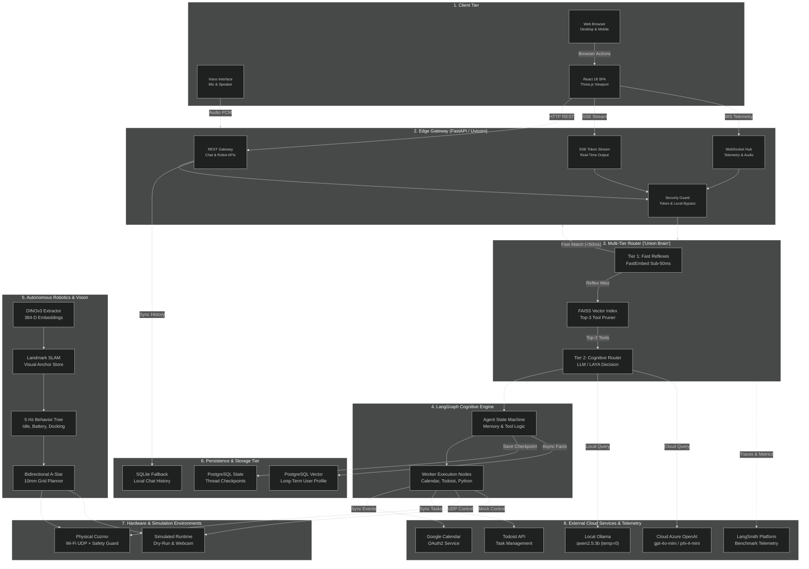
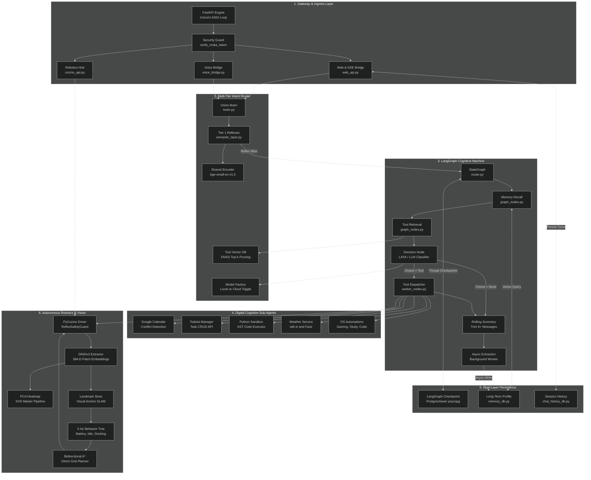
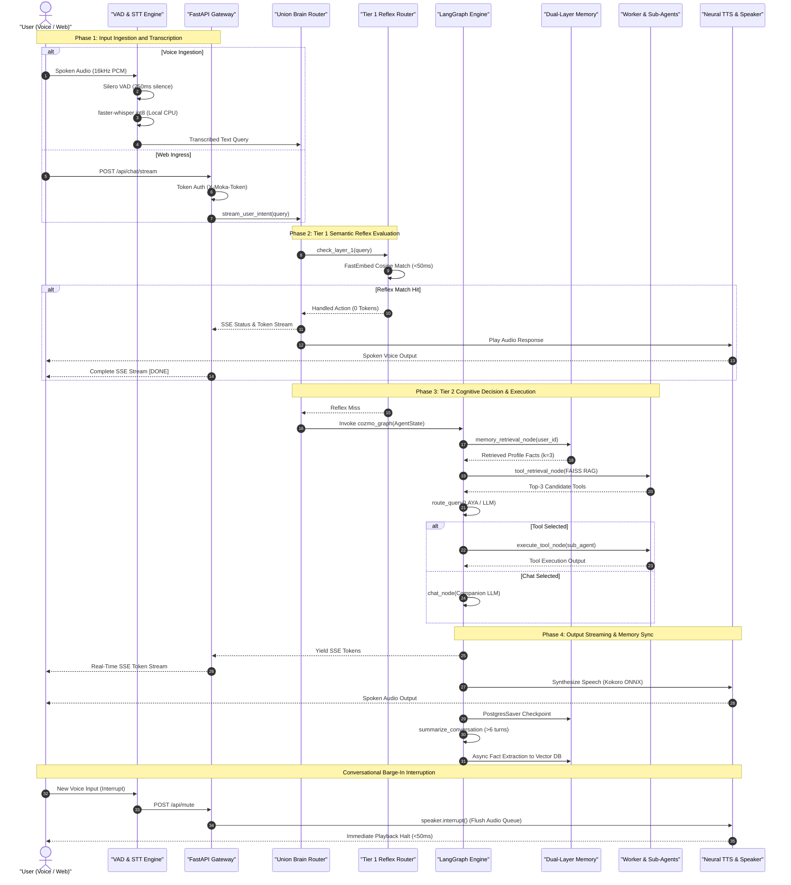
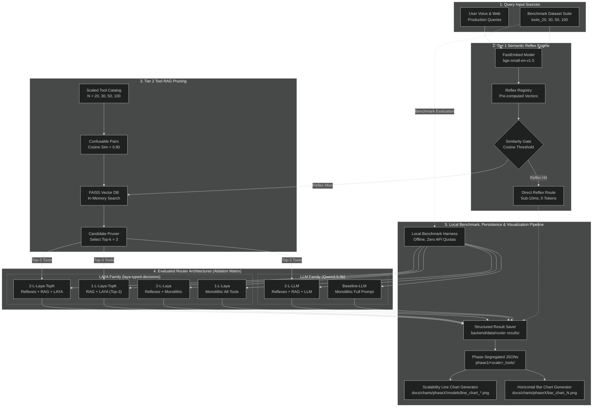
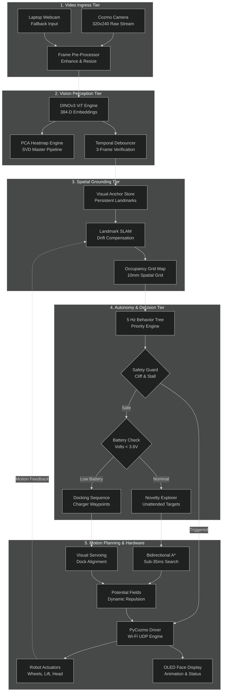

# High-Level Design (HLD): Moka AI Assistant & Tool-Routing Benchmark Suite

**Document Version:** 1.0  
**Date:** November 2026  
**Author:** Mohammad Kashefirad  
**Academic Supervisor:** Herr Christoph Vogl  
**Project Title:** Routing-Strukturen für große Tool-Mengen in einem LLM-basierten Desktop-Roboter-Assistenten: Ein Vergleich von Genauigkeit, Token-Verbrauch und Latenz  
**System Status:** Production & Evaluation Candidate  

---

## 1. Executive Summary & Document Purpose

The **Moka AI Assistant** is a local-first, multimodal cognitive system designed for dual deployment: as an interactive desktop assistant operating across speech, web, and spatial modalities, and as an empirical evaluation platform for scalable intent routing across large tool libraries ($N = 20 \dots 100$).

The purpose of this High-Level Design (HLD) document is to bridge the formal requirements defined in the [Software Requirements Specification (SRS)](file:///c:/Users/mkrad/PycharmProjects/moka_ai_assistant/srs.txt) and the underlying codebase implementation. It provides an architectural blueprint covering:
1. System context, runtime boundaries, and deployment topology.
2. Component decomposition across the multimodal bridge, intent router, cognitive state machine, dual-layer memory, and robotics vision engine.
3. End-to-end data pipelines for streaming speech, SSE token push, and episodic memory persistence.
4. The two-tier tool routing mechanisms and benchmark evaluation harness evaluating three distinct router architectures (Variants A, B, and C).
5. Cyber-physical perception and path planning running on physical hardware or gracefully degrading to simulated/webcam environments.
6. Interface contracts, security boundaries, and non-functional Service Level Objectives (SLOs).

### 1.1 Requirements Traceability Matrix (SRS Mapping)

| Requirement ID | Specification Category | Architectural Module / Implementation Target |
| :--- | :--- | :--- |
| **FR-M01** | Web UI & Gateway Bridge | FastAPI Backend (`web_api.py`), React 18 / Three.js Frontend SPA |
| **FR-M02** | Speech Input Pipeline | Silero VAD (250ms threshold, barge-in) + `faster-whisper` (int8 on CPU) |
| **FR-M03** | Speech Output & Interruption | Local neural TTS (`kokoro-onnx` / `edge-tts`) with instant speaker flush |
| **FR-M04** | Router Sandbox & Mocking | Standardized router contract dispatching to `MOCK_ACTION_DISPATCH` |
| **FR-M05** | Router A (Flat LLM Baseline) | Monolithic single-prompt baseline passing all $N$ tools to `qwen2.5:3b` |
| **FR-M06** | Router B (2-Layer LLM) | Tier 1 FastEmbed reflexes + FAISS Top-$k$ Tool RAG + `qwen2.5:3b` |
| **FR-M07** | Router C (2-Layer LAYA) | Tier 1 FastEmbed reflexes + FAISS Top-$k$ Tool RAG + `convaiinnovations/laya-typed-decisions` |
| **FR-M08** | Scaling Benchmark Harness | Automated batch runner (`compare_routers.py`) across $N \in \{20, 30, 50, 100\}$ tools |
| **FR-S01** | Short-Term Episodic Memory | LangGraph `PostgresSaver` via `psycopg_pool.ConnectionPool` (auto-reconnect, `max_idle=300`) + rolling summarizer node ($> 6$ messages) |
| **FR-S02** | Long-Term Biographical Memory| Asynchronous worker (`memory_extraction_node`) + **Mem0** with **PostgreSQL `pgvector`** (`moka_user_memories`) + Memory Reconciliation Engine + Markdown sync (`user_profile.md`) |
| **FR-S03** | Cognitive Sub-Agents | Specialized LangGraph sub-agents (Calendar, Todoist, Python Sandbox, Weather, Search) |
| **FR-S04** | Local / Cloud Model Toggle | Dynamic runtime switch in `llm_factory.py` (Local Ollama vs. Cloud Azure OpenAI) |
| **FR-S05** | Webcam DINOv3 Perception | Vision perception fallback (`--source webcam`), 384-D patch embeddings, PCA heatmaps |
| **FR-S06** | Simulated Autonomy | Dry-run mode (`--dry-run`), 5 Hz Behavior Tree, Landmark SLAM, Bidirectional A* |
| **FR-C01** | LAYA Architecture Variants | 4-configuration benchmark matrix (1-Layer vs 2-Layer, with/without Top-$k$ pruning) |
| **FR-C02** | Benchmark Scaling Dataset | Curated 300+ query evaluation dataset with confusable pairs ($\cos \theta > 0.80$) |
| **FR-C03** | Human-In-The-Loop Confirmation | `interrupt_before` gate for state-mutating digital actions |
| **FR-C04** | Document QA (RAG) | Semantic document ingestion ETL pipeline for PDF, TXT, and Markdown files |
| **FR-C05** | Dynamic MCP Tool Ingestion | Runtime discovery and vector indexing of external Model Context Protocol tools |
| **NFR-P01** | Reflex Latency SLO | Tier 1 FastEmbed matching converges at $P_{95} < 50\,\text{ms}$ on CPU |
| **NFR-P02** | Motion Planning Latency | Bidirectional A* grid search terminates in $< 35\,\text{ms}$ on a 10mm grid |
| **NFR-P03** | Vision Perception Rate | Asynchronous DINOv3 patch extraction maintains $\ge 15\,\text{FPS}$ |
| **NFR-S01** | API Security & Authorization | Admin token validation via `X-Moka-Token` with secure localhost bypass |
| **NFR-R01** | Hardware-Free Degradation | Flawless standalone execution without physical robot connection |
| **NFR-U01** | Conversational Brevity | Spoken brevity guardrails enforce $< 2$ sentences and zero markdown formatting |

---

## 2. System Context & Ecosystem Architecture

The Moka ecosystem is structured into distinct tiers operating local-first. It decouples the client presentation layers, edge services, persistence backends, execution runtimes, and external telemetry systems.

### 2.1 Ecosystem Context Diagram (Diagram 1)

The following diagram illustrates the high-level boundary of the Moka AI Assistant, its internal subsystems, local hardware drivers, database backends, and external third-party cloud services.



### 2.2 System Component Specifications & Mappings

To keep architectural diagrams readable and prevent visual text clipping, granular endpoints, paths, and technical parameters are mapped in the reference table below:

| Architectural Node | Technical Component & Path | Functionality & Protocol |
| :--- | :--- | :--- |
| **REST Gateway** | `core/modes/web_api.py` (`/api/chat`, `/api/history`, `/api/model-mode`) | Handles synchronous REST requests, conversation CRUD, and model configuration toggles. |
| **SSE Token Stream** | `core/modes/web_api.py` (`/api/chat/stream`) | Server-Sent Events endpoint pushing real-time token streams and reasoning stage telemetry. |
| **WebSocket Hub** | `core/modes/voice_bridge.py` & `cozmo_api.py` (`/ws/cozmo/telemetry`) | 20 Hz bidirectional telemetry streaming (pose, battery, vision anchors) and voice state events. |
| **Security Guard** | `verify_moka_token` in `web_api.py` | Validates `X-Moka-Token` against `MOKA_ADMIN_TOKEN` with automatic local development bypass. |
| **Tier 1: Fast Reflexes** | `core/routing/layer1/semantic_layer.py` | Sub-50ms deterministic cosine matching over `bge-small-en-v1.5` embeddings for instant commands. |
| **FAISS Vector Index** | `core/routing/layer2/tool_vector_db.py` | Real-time candidate pruning pulling Top-$k$ ($k=3$) relevant tools out of $N=20\dots 100$ tools. |
| **Tier 2: Cognitive Router** | `core/routing/layer2/graph_nodes.py` (`route_query`) | Evaluates pruned candidate tools via `convaiinnovations/laya-typed-decisions` or `qwen2.5:3b`. |
| **Agent State Machine** | `core/routing/layer2/router.py` (`builder = StateGraph(AgentState)`) | Orchestrates state transitions: Memory Recall $\to$ RAG $\to$ Routing $\to$ Execution $\to$ Summarization. |
| **Worker Execution Nodes** | `core/routing/layer2/worker_nodes.py` | Dispatches tool calls to sub-agents (Google Calendar, Todoist, Python Code Sandbox, Weather). |
| **DINOv3 Extractor** | `autonomous_cozmo/vision/dino_extractor.py` | Generates 384-dimensional ViT patch embeddings and SVD Master PCA heatmaps at $\ge 15\,\text{FPS}$. |
| **Landmark SLAM** | `autonomous_cozmo/vision/landmark_slam.py` & `anchor_store.py` | Maintains dynamic visual anchors, spatial landmarks, and odometry drift corrections. |
| **5 Hz Behavior Tree** | `autonomous_cozmo/behavior/tree.py` (`py_trees`) | Priority-based autonomous decision tree managing battery safety, wander exploration, and docking. |
| **Bidirectional A\*** | `autonomous_cozmo/motion/bidirectional_astar.py` | Computes collision-free paths in $< 35\,\text{ms}$ on a 10mm discretized grid. |
| **PostgreSQL State** | `PostgresSaver` via `psycopg` (table `checkpoints`) | Transactional thread-level checkpointing for multi-turn conversation persistence. |
| **PostgreSQL Vector** | `schemas/memory_db.py` (collection `moka_user_memories`) | Production-grade persistent user profiling via Mem0 + pgvector, few-shot memory reconciliation (update/delete), and 2-way markdown sync (`backend/sync_memory.py`). |

---

## 3. Technology Stack & Operating Environment

The technology stack is selected to fulfill strict local-first, privacy-preserving, and latency-bounded constraints while supporting seamless evaluation against cloud frontier models.

### 3.1 Technology Matrix

| Layer / Subsystem | Technology / Library | Version / Model | Architectural Rationale |
| :--- | :--- | :--- | :--- |
| **Web UI Framework** | React + Vite + TypeScript | React 18.3, Vite 5.x | High-performance SPA with Vertical Slice modularity and instant HMR. |
| **3D & Visualizations**| Three.js / ThreeUI | Three.js r128+ | Real-time 2D/3D visual rendering of robot trajectory, obstacle grid, and PCA heatmaps. |
| **API Gateway** | FastAPI + Uvicorn | FastAPI 0.110+, Python 3.10+ | Asynchronous event loop natively supporting ASGI, WebSockets, and SSE token streaming. |
| **Audio Processing** | Silero VAD | v4.0 / ONNX | High-precision voice activity detection (250ms threshold) with zero cloud dependency. |
| **Speech-to-Text** | `faster-whisper` | base.en / small.en (int8 CPU) | Low-latency local transcription optimized via CTranslate2 on commodity CPU hardware. |
| **Text-to-Speech** | `kokoro-onnx` / `edge-tts` | Kokoro v0.19 ONNX | Natural local neural voice synthesis with immediate thread interruption and queue flush. |
| **Tier 1 Embeddings** | FastEmbed | `BAAI/bge-small-en-v1.5` | Quantized local embeddings computing text similarities in $< 5\,\text{ms}$ on CPU. |
| **Tier 1 Routing** | Semantic Router | Custom Hash & Cosine Router | Deterministic mapping of recurring intents to instant action handlers. |
| **Tier 2 Tool RAG** | FAISS (CPU) | `faiss-cpu` 1.8+ | In-memory indexing and Euclidean/Cosine similarity retrieval for Top-$k$ tool pruning. |
| **Tier 2 Decision Engine**| LAYA Typed Decisions | `convaiinnovations/laya-typed-decisions` | Lightweight, highly constrained classification model specialized for deterministic routing. |
| **Local LLM Runtime** | Ollama | `qwen2.5:3b` (temp=0.0) | High-performance local quantized LLM for baseline routing and companion conversation. |
| **Cloud LLM Runtime** | Azure OpenAI SDK | `gpt-4o-mini` / `phi-4-mini` | Low-latency cloud fallback providing frontier-grade reasoning when toggled. |
| **Cognitive Framework** | LangGraph & LangChain | LangGraph 0.2+, LangChain Core | State machine orchestration supporting persistence, checkpointing, and conditional transitions. |
| **Short-Term Memory** | `langgraph-checkpoint-postgres` | PostgreSQL 15+ (`psycopg_pool.ConnectionPool`) | Resilient, pooled thread-level checkpointing supporting serverless idle timeouts (Neon scale-to-zero) and multi-turn pause/resume. |
| **Long-Term Memory** | PostgreSQL `pgvector` via Mem0 | `mem0ai` + FastEmbed (`BAAI/bge-small-en-v1.5`) | High-concurrency vector store with intelligent contradiction reconciliation (UPDATE/DELETE/ADD) and 2-way markdown sync. |
| **Vision Perception** | DINOv3 (PyTorch / ONNX) | ViT-Small (384-D patches) | Self-supervised foundational vision backbone generating invariant patch embeddings. |
| **Motion & Planning** | Custom Python Engine | Bidirectional A* + Potential Fields | High-speed path planning ($< 35\,\text{ms}$) on a 10mm discretized 2D spatial grid. |
| **Robot Driver & Safety**| PyCozmo | PyCozmo 0.9+ with `ReflexSafetyGuard` | Low-level packet protocol over Wi-Fi UDP with hardware cliff and motor stall fail-safes. |
| **Benchmark Telemetry** | LangSmith SDK | LangSmith 0.1+ | Automated tracing, evaluation dataset versioning, latency percentile, and token tracking. |

## 4. Subsystem Decomposition & Component Anatomy

The Moka AI Assistant decomposes into five core subsystems with strictly defined unidirectional interfaces, event loops, and isolation boundaries.

### 4.1 Component Interaction & Subsystem Decomposition Diagram (Diagram 2)

The following diagram details the internal modular anatomy of Moka Core, illustrating how runtime requests flow across the API Gateway, the Union Brain router, LangGraph cognitive state machine, dual memory tiers, digital sub-agents, and the cyber-physical robotics loop.



---

### 4.2 Subsystem Technical Specifications

#### 4.2.1 Gateway & Presentation Subsystem
* **File Location:** [`backend/core/modes/web_api.py`](file:///c:/Users/mkrad/PycharmProjects/moka_ai_assistant/backend/core/modes/web_api.py), [`voice_bridge.py`](file:///c:/Users/mkrad/PycharmProjects/moka_ai_assistant/backend/core/modes/voice_bridge.py), [`cozmo_api.py`](file:///c:/Users/mkrad/PycharmProjects/moka_ai_assistant/backend/core/modes/cozmo_api.py)
* **Responsibilities:**
  1. Serves the pre-compiled Single Page Application (SPA) production bundle (`frontend/dist`) via FastAPI static mount.
  2. Implements real-time Server-Sent Events (SSE) via `/api/chat/stream`, yielding pipeline telemetry (`INTENT ROUTER`, `FAST-PATH REFLEX`, `EPISODIC MEMORY`) followed by token chunks.
  3. Houses the `VoiceBridge` hub managing real-time microphone capture, wake-up state broadcasting, and UI synchronizations.
  4. Provides the `/ws/cozmo/telemetry` WebSocket operating at 20 Hz, serializing robot coordinates $(x, y, \theta)$, battery millivolts, cliff sensor states, and detected visual anchor clusters.
  5. Enforces token security via `verify_moka_token`, verifying the `X-Moka-Token` header against `MOKA_ADMIN_TOKEN` with automatic bypass for `localhost` loopback requests.

#### 4.2.2 Multi-Tier Intent Routing Engine ("Union Brain")
* **File Location:** [`backend/core/routing/brain.py`](file:///c:/Users/mkrad/PycharmProjects/moka_ai_assistant/backend/core/routing/brain.py), [`layer1/semantic_layer.py`](file:///c:/Users/mkrad/PycharmProjects/moka_ai_assistant/backend/core/routing/layer1/semantic_layer.py), [`layer2/tool_vector_db.py`](file:///c:/Users/mkrad/PycharmProjects/moka_ai_assistant/backend/core/routing/layer2/tool_vector_db.py), [`llm_factory.py`](file:///c:/Users/mkrad/PycharmProjects/moka_ai_assistant/backend/core/routing/llm_factory.py)
* **Responsibilities:**
  1. **Tier 1 (Semantic Reflexes):** Executes deterministic semantic classification using `FastEmbed` (`BAAI/bge-small-en-v1.5`). Queries are evaluated against vector embeddings of registered utterances in $< 50\,\text{ms}$ ($P_{95}$). When similarity exceeds the threshold, execution completes with 0 LLM tokens.
  2. **Tier 2 Tool RAG Pruning:** When Tier 1 yields a miss, the query enters FAISS-CPU vector indexing (`tool_rag_registry`). It filters down an expansive tool registry ($N=20 \dots 100$) to the top $k=3$ most semantically relevant candidate tools.
  3. **Cognitive Router Selection:** Dispatches candidate tools to either the lightweight specialized `convaiinnovations/laya-typed-decisions` classifier or the active LLM (`qwen2.5:3b` / Azure OpenAI).
  4. **Dynamic LLM Factory:** Manages active chat and router models via runtime environment toggling (`provider="local"` vs. `provider="cloud"`).

#### 4.2.3 LangGraph Cognitive State Machine & Worker Nodes
* **File Location:** [`backend/core/routing/layer2/router.py`](file:///c:/Users/mkrad/PycharmProjects/moka_ai_assistant/backend/core/routing/layer2/router.py), [`graph_nodes.py`](file:///c:/Users/mkrad/PycharmProjects/moka_ai_assistant/backend/core/routing/layer2/graph_nodes.py), [`worker_nodes.py`](file:///c:/Users/mkrad/PycharmProjects/moka_ai_assistant/backend/core/routing/layer2/worker_nodes.py)
* **Responsibilities:**
  1. Coordinates the compiled state machine using LangGraph's `StateGraph(AgentState)`:
     $$\text{START} \to \text{memory\_retrieval} \to \text{tool\_retrieval} \to \text{route\_query} \to \{\text{execute\_tool} \mid \text{chat}\} \to \text{summarize} \to \text{memory\_extraction} \to \text{END}$$
  2. **Context Window Optimization:** In `summarize_conversation_node`, whenever the active conversation history exceeds 6 messages, older turns are summarized into a rolling context string and deleted via `RemoveMessage(id=m.id)` to keep prompt sizes bounded.
  3. **Digital Sub-Agent Dispatch:**
     * **Google Calendar Agent:** LangGraph agent executing conflict detection and event creation via Google Calendar API OAuth2 tokens.
     * **Todoist Agent:** RESTful task synchronization, priority tagging, and checklist completion.
     * **Python Code Sandbox:** AST-validated isolated Python code executor for math and programmatic data transformations.
     * **Weather Agent:** Dual-output worker fetching real-time weather via `wttr.in`/Open-Meteo while rendering animated weather icons (sunny, rainy, snowy, cloudy) directly to the Cozmo OLED face buffer.
     * **Workstation Automation:** Desktop setup automation for study, gaming, and development profiles.

#### 4.2.4 Dual-Layer Conversational Memory Subsystem
* **File Location:** [`backend/schemas/memory_db.py`](file:///c:/Users/mkrad/PycharmProjects/moka_ai_assistant/backend/schemas/memory_db.py), [`backend/sync_memory.py`](file:///c:/Users/mkrad/PycharmProjects/moka_ai_assistant/backend/sync_memory.py), [`backend/data/user_profile.md`](file:///c:/Users/mkrad/PycharmProjects/moka_ai_assistant/backend/data/user_profile.md), [`chat_history_db.py`](file:///c:/Users/mkrad/PycharmProjects/moka_ai_assistant/backend/schemas/chat_history_db.py), [`router.py`](file:///c:/Users/mkrad/PycharmProjects/moka_ai_assistant/backend/core/routing/layer2/router.py#L47-L75)
* **Responsibilities:**
  1. **Short-Term Episodic Memory:** Implemented via `PostgresSaver(pool)` backed by a resilient `psycopg_pool.ConnectionPool` (`check=ConnectionPool.check_connection`, `max_idle=300`, `autocommit=True`). Checkpoints thread states across conversational turns, automatically handling serverless Neon PostgreSQL scale-to-zero idle disconnections without dropped connections.
  2. **Long-Term Biographical Memory:** Non-blocking background worker (`memory_extraction_node`) that runs asynchronously after every assistant turn. It parses the dialogue for persistent user facts (identity, field of study, preferred programming languages, favorite sports teams), filtering out ephemeral details (weather, time, dates).
  3. **Profile Vector Store (Mem0 on `pgvector`):** Powered by **Mem0** using PostgreSQL `pgvector` on Neon (`collection_name="moka_user_memories"`, 384-dimensional FastEmbed embeddings `BAAI/bge-small-en-v1.5`). Native database transactions eliminate Windows file locking issues and support concurrent access across the web API, background threads, and test runners.
  4. **Intelligent Memory Reconciliation Engine:** Features a deterministic few-shot reconciliation pass (`_reconcile_dialogue`) that compares recent dialogue against existing memories. Automatically detects:
     - `UPDATE`: In-place updates when an existing fact or identity is corrected (e.g. name changed from Michael to Mohammad).
     - `DELETE`: Complete deletion when the user asks to forget or negate a fact.
     - `ADD`: Incremental insertion of brand new permanent traits.
  5. **Two-Way Markdown Profile Sync:** Live memories are automatically formatted into [`backend/data/user_profile.md`](file:///c:/Users/mkrad/PycharmProjects/moka_ai_assistant/backend/data/user_profile.md). Developers and users can inspect, edit, add, or delete facts by hand in markdown, and sync them back to pgvector via `python backend/sync_memory.py`.

#### 4.2.5 Autonomous Robotics, Spatial Vision & Motion Subsystem
* **File Location:** [`backend/autonomous_cozmo/vision/`](file:///c:/Users/mkrad/PycharmProjects/moka_ai_assistant/backend/autonomous_cozmo/vision/), [`motion/`](file:///c:/Users/mkrad/PycharmProjects/moka_ai_assistant/backend/autonomous_cozmo/motion/), [`behavior/`](file:///c:/Users/mkrad/PycharmProjects/moka_ai_assistant/backend/autonomous_cozmo/behavior/), [`core/hardware/`](file:///c:/Users/mkrad/PycharmProjects/moka_ai_assistant/backend/core/hardware/)
* **Responsibilities:**
  1. **DINOv3 Visual Perception:** Extracts 384-D self-supervised patch embeddings from camera frames at $\ge 15\,\text{FPS}$. Implements SVD Master PCA projection to render high-contrast visual saliency heatmaps.
  2. **Visual Memory & Temporal Debouncing:** Uses `TemporalDebouncer` to filter out sensor glints and transient noise, requiring visual landmarks to persist across 3 consecutive frames before anchoring them in `VisualAnchorStore`.
  3. **Landmark SLAM:** Dynamically updates robot position $(x, y, \theta)$ relative to persistent visual anchors, compensating for physical wheel slip and odometry drift.
  4. **5 Hz Behavior Tree:** Built on `py_trees`, executing hierarchical priority behaviors:
     $$\text{Reflex Safety Guard} \succ \text{Critical Battery Monitor} \succ \text{Novelty Exploration Wander} \succ \text{Autonomous Docking}$$
  5. **Bidirectional A\* Path Planning:** Computes shortest collision-free paths over a discretized 10mm spatial grid in $< 35\,\text{ms}$, coupled with Artificial Potential Fields for dynamic obstacle repulsion and Visual Servoing for dock alignment.
  6. **Hardware Driver & Fail-Safe:** Communicates via PyCozmo over Wi-Fi UDP. The `ReflexSafetyGuard` continuously monitors drop sensors (cliff detection) and wheel motor current (stall detection), instantly halting motion if the robot leaves the desk surface.

## 5. Multimodal Streaming & Data Flow Pipelines

The Moka AI Assistant operates across synchronous request-response cycles, real-time token streaming, and non-blocking background workers.

### 5.1 Multimodal End-to-End Data Flow Diagram (Diagram 3)

The following sequence diagram tracks the end-to-end lifecycle of user interactions across voice and web modalities, illustrating the Tier 1 fast reflex branch, the Tier 2 cognitive LangGraph branch, real-time SSE token delivery, and conversational barge-in interruptions.



---

### 5.2 Speech Processing Pipeline & Barge-In Lifecycle

1. **Audio Acquisition & Voice Activity Detection (VAD):**
   * Spoken audio is recorded continuously at 16 kHz (16-bit mono PCM).
   * **Silero VAD v4** processes the raw PCM stream in non-overlapping frames.
   * A silence threshold of **250 ms** is configured to detect end-of-turn speech without clipping conversational pauses or filler words.
2. **Local Transcription (STT):**
   * Captured audio buffers are passed to **`faster-whisper`** executing in quantized `int8` on the local host CPU.
   * Audio transcription achieves latency under $300\,\text{ms}$ without dispatching speech data outside the local machine, preserving complete privacy.
3. **Conversational Barge-In & Queue Flushing:**
   * If the user begins speaking while the robot or assistant is currently producing spoken output, the VAD layer instantly fires a high-priority cancellation event.
   * `VoiceBridge` triggers `speaker.interrupt()` (and the web UI calls `/api/mute`), wiping the local audio playback buffer and resetting PyCozmo OLED animation queues within $< 50\,\text{ms}$.

---

### 5.3 Real-Time SSE Token Streaming & Web Chat Pipeline

The web chat interface connects directly to `/api/chat/stream`, which generates real-time Server-Sent Events (SSE) structured into distinct pipeline stages:

```
+--------------------------------------------------------------------------------------------------+
|                                    SSE PROTOCOL ENVELOPE FORMAT                                  |
+--------------------------------------------------------------------------------------------------+
| 1. Intent Stage:    data: {"type": "status", "stage": "intent", "step": 1, ...}                  |
| 2. Reflex Stage:    data: {"type": "status", "stage": "reflex", "tool": "get_date", ...}         |
| 3. Memory Stage:    data: {"type": "status", "stage": "memory", "title": "EPISODIC MEMORY", ...}|
| 4. Token Stream:    data: {"type": "token", "token": "Today "}                                    |
|                     data: {"type": "token", "token": "is "}                                       |
|                     data: {"type": "token", "token": "Monday."}                                   |
| 5. Stream Terminal: data: [DONE]                                                                 |
+--------------------------------------------------------------------------------------------------+
```

1. **Pipeline Status Envelopes:**
   * Informs the frontend of the active cognitive stage (`INTENT ROUTER`, `FAST-PATH REFLEX`, or `EPISODIC MEMORY`), allowing the UI to display animated reasoning step pills to the user.
2. **Token-by-Token Emission:**
   * LLM generation chunks are pushed as individual JSON payloads (`{"type": "token", "token": "..."}`) directly over the open HTTP stream, providing near-instant perceived response time (Time To First Token $< 450\,\text{ms}$).
3. **Stream Completion & Persistence:**
   * Upon receiving `data: [DONE]`, the client finalizes message rendering. Simultaneously, the backend accumulates all streamed chunks into a single message string and persists it to `chat_history_db` in a single non-blocking database write.

---

### 5.4 Synchronous vs. Asynchronous Execution Paths

To guarantee responsiveness across local edge hardware, computational tasks are categorized into synchronous critical paths and asynchronous background paths:

| Execution Path | Operations Included | Execution Target & Concurrency Strategy |
| :--- | :--- | :--- |
| **Synchronous Critical Path** | VAD speech slicing, FastEmbed cosine similarity, FAISS Top-$k$ tool pruning, LAYA / LLM inference, Tool execution dispatch. | Blocks the active request thread or async generator until the output token/action is generated. Bounded by $P_{95} < 50\,\text{ms}$ (Reflex) or $< 1.5\,\text{s}$ (Cognitive LLM). |
| **Asynchronous Stream Path** | SSE token emission, Cozmo OLED face rendering, 20 Hz telemetry WebSocket broadcast, PyCozmo motor commands. | Managed via `asyncio.create_task()` or background tasks on the FastAPI event loop, preventing socket starvation. |
| **Non-Blocking Background Path** | Rolling conversation summarization (`summarize_conversation_node`), biographical trait extraction (`memory_extraction_node`), LangSmith trace logging. | Executed in dedicated Python OS threads (`threading.Thread(daemon=False)`) after response delivery. Guarantees database writes finish even if the client disconnects immediately. |

## 6. Pluggable Two-Tier Tool-Routing & Scalable Benchmark Suite

A central contribution of the system (anchoring Chapter 3 of the Bachelor's thesis) is the empirical comparison of scalable tool-routing architectures across growing tool catalogs ($N = 20, 30, 50, 100$).

### 6.1 Two-Tier Routing Decision Tree & Benchmark Pipeline Diagram (Diagram 4)

The following diagram illustrates the routing decision tree: from query ingestion and Tier 1 semantic reflexes, through FAISS candidate pruning over scaled registries with confusable pairs, to the six evaluated router variants in the local benchmarking harness, automated result persistence (`saver.py`), and visualization generator:



---

### 6.2 Architectural Routing Paradigms & Variant Taxonomy

The benchmark harness formally compares six router configurations, providing a full ablation study across Layer 1 reflexes, Tool RAG candidate pruning, and model choice (monolithic generative LLM vs. constrained typed cross-encoder):

| Model Identifier | Architecture Description | Layer 1 Reflexes | Layer 2 Filtering | Decision Engine | Token Profile |
| :--- | :--- | :--- | :--- | :--- | :--- |
| **Baseline-LLM** | Monolithic Single-Shot LLM | None (All queries reach LLM) | None (All $N$ tools in prompt) | Local Ollama (`qwen2.5:3b`, temp=0.0) | High ($\mathcal{O}(N)$ prompt tokens) |
| **2-L-LLM** | Production Two-Layer LLM | FastEmbed (`bge-small-en-v1.5`) | FAISS Top-$k$ ($k=3$) | Local Ollama (`qwen2.5:3b`, temp=0.0) | Low ($\mathcal{O}(k)$ bounded tokens) |
| **1-L-Laya** | Monolithic Single-Layer LAYA | None | None (All $N$ tools evaluated) | `convaiinnovations/laya-typed-decisions` | **0 tokens** (Local classification) |
| **2-L-Laya** | Two-Layer Monolithic LAYA | FastEmbed (`bge-small-en-v1.5`) | None (All $N$ tools evaluated) | `convaiinnovations/laya-typed-decisions` | **0 tokens** (Local classification) |
| **1-L-Laya-TopK**| Single-Layer Top-$K$ LAYA | None | FAISS Top-$k$ ($k=3$) | `convaiinnovations/laya-typed-decisions` | **0 tokens** (Local classification) |
| **2-L-Laya-TopK**| Two-Layer Top-$K$ LAYA | FastEmbed (`bge-small-en-v1.5`) | FAISS Top-$k$ ($k=3$) | `convaiinnovations/laya-typed-decisions` | **0 tokens** (Local classification) |

---

### 6.3 Scaled Tool Registry Expansion ($N = 20, 30, 50, 100$)

To simulate real-world robotic and desktop operating environments, the tool registry scales across four cumulative tiers ($N \in \{20, 30, 50, 100\}$), clustered into five functional domains:

1. **Productivity & Time Management:** Calendar scheduling, Todoist tasks, alarm timers, clock synchronization.
2. **Desktop & System Administration:** File management, shell script execution, Python code sandbox, workstation profile toggles (Gaming, Coding, Study).
3. **Audio & Media Control:** Volume modulation, playback control, music streaming, mute interrupts.
4. **Robot Locomotion & Spatial Actions:** Drive forward/backward, arc sweep surround scan, head tilt, lift height, charger docking.
5. **Smart Home & Environment:** Thermostat adjustment, weather queries, ambient lighting control.

#### Confusable Pair Synthesis & Stress-Testing
To rigorously test boundary discrimination and evaluate hallucination under high semantic density, the scaling suites incorporate deliberate **confusable tool pairs** exhibiting high vector cosine similarity ($\cos(\vec{u}, \vec{v}) > 0.80$):
* `schedule_meeting` vs. `set_reminder` (Productivity overlap)
* `open_browser` vs. `search_web` (Information retrieval overlap)
* `mute_audio` vs. `stop_music` (Media control overlap)
* `turn_around` vs. `arc_sweep` (Physical locomotion overlap)

---

### 6.4 Local Benchmark Harness, Result Persistence & Visualizations

The benchmarking suite is orchestrated via `backend/test/routers/experiments/*.py` and `harness.py`, operating independently of external cloud rate limits:

1. **Local Deterministic Harness (`harness.py`):**
   * Decoupled from cloud trace ingestion to ensure zero rate-limit blocks and reproducible execution.
   * Loads standardized test suites directly from `backend/test/routers/benchmark_dataset/` (`tools_20`, `tools_30`, `tools_50`, `tools_100`).
   * Measures **Top-1 Accuracy**, **P50/Mean/P90/Min/Max Latency**, **Per-Category Accuracy**, and **Cumulative Tokens**.
2. **Structured Persistence & Phase Tracking (`saver.py`):**
   * Results are segregated by research iteration phase to support progressive model improvement:
     `backend/data/router results/<phase>/<scale>_tools/<model_name>.json`
     (e.g., `backend/data/router results/phase1/20_tools/2_L_LLM.json`).
   * Each JSON file stores full prediction traces, allowing post-hoc confusion matrix analysis and error auditing.
3. **Publication Visualizations (`bar_chart.py` & `line_chart.py`):**
   * **Comparative Horizontal Bar Charts:** Automatically generated in `docs/charts/<phase>/bar_chart_<scale>_tools.png` comparing Accuracy, Latency (P50 and Mean), and Token Count across all models in that scale.
   * **Scalability Trajectory Line Charts:** Generated on demand in `docs/charts/<phase>/models/line_chart_<model>.png`, plotting accuracy degradation, latency scaling, and token consumption across $N = 20 \to 100$.

#### Phase 1 Empirical Benchmark Baseline (20 Tools)

| Model Configuration | Top-1 Accuracy | Median ($P_{50}$) Latency | Mean Latency | Total Tokens | Architectural Advantage |
| :--- | :--- | :--- | :--- | :--- | :--- |
| **2-L-Laya-TopK** | **87.3%** (55/63) | **5.5 ms** | 217.3 ms | **0** | Highest accuracy, lowest median latency, zero LLM cost |
| **Baseline-LLM** | **87.3%** (55/63) | 1007.4 ms | 1604.7 ms | 73,496 | High accuracy but severe token overhead & latency |
| **2-L-LLM** | **85.7%** (54/63) | **5.6 ms** | 500.7 ms | 4,704 | **93.6% token reduction** vs. Baseline with near-identical accuracy |
| **1-L-Laya-TopK** | **82.5%** (52/63) | 537.5 ms | 503.2 ms | **0** | Fast retrieval + lightweight classification |
| **2-L-Laya** | **82.5%** (52/63) | **7.5 ms** | 351.3 ms | **0** | Instant reflex execution on physical tasks |
| **1-L-Laya** | **68.3%** (43/63) | 814.9 ms | 829.7 ms | **0** | Monolithic cross-encoder without RAG pruning |

## 7. Cyber-Physical Vision, Spatial Memory & Motion Control Loop

The cyber-physical subsystem provides real-time spatial awareness, foundational vision grounding, and autonomous navigation. It operates with low-latency closed-loop control whether connected to the physical Cozmo robot over Wi-Fi UDP or executing in hardware-free simulation (`--dry-run` and `--source webcam`).

### 7.1 Autonomous Vision & Cyber-Physical Control Loop Diagram (Diagram 5)

The following diagram models the autonomous perception-action loop: from visual stream acquisition and DINOv3 patch extraction, through Landmark SLAM and the 5 Hz Behavior Tree, to Bidirectional A\* grid planning and PyCozmo motor actuation guarded by hardware drop sensors.



---

### 7.2 Computer Vision & Spatial Memory Pipeline

1. **Foundational Vision Extraction (DINOv3):**
   * Video frames ($320 \times 240$ from Cozmo or $640 \times 480$ from webcam) are normalized and fed into the self-supervised **DINOv3** Vision Transformer backbone (`autonomous_cozmo/vision/dino_extractor.py`).
   * Generates a 384-dimensional dense patch embedding tensor per frame at $\ge 15\,\text{FPS}$ without requiring supervised object class labels.
2. **SVD Master PCA Heatmap Visualization:**
   * High-dimensional patch embeddings are projected to 3 principal color dimensions via Singular Value Decomposition (SVD), rendering normalized RGB saliency heatmaps served via the MJPEG stream (`/api/cozmo/video_feed`).
3. **Temporal Debouncing (`TemporalDebouncer`):**
   * Optical glints, rapid lighting transitions, and transient sensor noise are suppressed by requiring prospective visual anchors to maintain feature cosine similarity $> 0.75$ across **3 consecutive frames** before confirmation.
4. **Visual Anchor Memory & Landmark SLAM:**
   * Confirmed visual targets are indexed in `VisualAnchorStore` with 2D ground projection coordinates.
   * As the robot navigates, relative observations to known anchors are compared against wheel odometry, continuously correcting for track slip and rotational drift.

---

### 7.3 Autonomy Hierarchy & Motion Planning

1. **5 Hz Behavior Tree (`py_trees`):**
   * Executes every $200\,\text{ms}$ with strict preemptive priority logic:
     $$\text{Reflex Safety Halt} \succ \text{Critical Low Battery Docking} \succ \text{Novelty Landmark Exploration} \succ \text{Idle Scan}$$
2. **Bidirectional A\* Grid Planning:**
   * Navigates over a 2D occupancy grid discretized at **10 mm resolution**.
   * By expanding frontiers simultaneously from start and goal nodes, search convergence terminates in **$< 35\,\text{ms}$** ($P_{95}$), well within the 200ms tick window.
3. **Artificial Potential Fields & Visual Servoing:**
   * Potential field repulsion vectors prevent clipping static desk boundaries or detected ground obstacles.
   * During terminal docking approaches, visual servoing uses camera visual feedback to guide the robot into alignment with charger electrical contacts.
4. **PyCozmo Driver & Reflex Safety Guard:**
   * Communicates with physical robot hardware over low-overhead Wi-Fi UDP packets.
   * The hardware `ReflexSafetyGuard` monitors the 4 infrared cliff sensors under the chassis. If any sensor detects a desk drop (cliff condition), motor power is cut in $< 10\,\text{ms}$, preventing falls.

---

## 8. Interfaces, API Specifications & Security Architecture

The system provides synchronous REST endpoints, Server-Sent Events (SSE) token streaming, and low-latency WebSockets.

### 8.1 REST & Streaming Endpoint Specifications

| Endpoint Path | HTTP Method | Authentication | Request Payload / Params | Response Structure & Description |
| :--- | :--- | :--- | :--- | :--- |
| `/api/chat` | `POST` | `X-Moka-Token` | `ChatRequest { message, session_id, mute, provider }` | JSON response containing the synthesized answer and active provider. |
| `/api/chat/stream` | `POST` | `X-Moka-Token` | `ChatRequest { message, session_id, mute, provider }` | Server-Sent Events (`text/event-stream`) streaming status envelopes and token chunks. |
| `/api/history` | `GET` | `X-Moka-Token` | None | Returns all conversation sessions, messages, and active storage backend (postgres/sqlite). |
| `/api/history/{id}` | `GET` | `X-Moka-Token` | Path `session_id` | Returns complete message thread history for a single conversation session. |
| `/api/history/{id}` | `PATCH` | `X-Moka-Token` | `RenameSessionRequest { title }` | Renames the session title in the persistence store. |
| `/api/history/{id}` | `DELETE` | `X-Moka-Token` | Path `session_id` | Deletes the specified conversation session and checkpoints. |
| `/api/history/sync-langsmith` | `POST` | `X-Moka-Token` | None | Synchronizes the 50 most recent conversation traces from LangSmith into local DB. |
| `/api/model-mode` | `GET` / `POST` | `X-Moka-Token` | `ModelModeRequest { provider: 'local' \| 'cloud' }` | Inspects or switches the cognitive model provider between Ollama and Azure OpenAI. |
| `/api/mute` | `POST` | `X-Moka-Token` | None | High-priority endpoint immediately interrupting speaker playback and flushing queues. |
| `/api/token/local` | `GET` | None (Localhost only)| None | Returns configured `MOKA_ADMIN_TOKEN` when visited from loopback (`127.0.0.1` / `::1`). |
| `/api/cozmo/command`| `POST` | `X-Moka-Token` | `MoveRequest`, `LiftRequest`, `HeadRequest`, etc. | Direct hardware control endpoint for wheel driving, head tilt, lift, and headlights. |
| `/api/cozmo/video_feed`| `GET` | None | Query `?heatmap=true&amp;grid=true` | MJPEG multipart live video stream (`multipart/x-mixed-replace; boundary=frame`). |

### 8.2 WebSocket Telemetry Schema (`/ws/cozmo/telemetry`)

Broadcasts at 20 Hz to all connected frontend clients:

```json
{
  "type": "cozmo_telemetry",
  "connected": true,
  "battery_voltage": 3.82,
  "is_charging": false,
  "head_pitch_deg": 14.5,
  "lift_height_mm": 32.0,
  "pose": {
    "x": 120.4,
    "y": -45.2,
    "theta_deg": 88.6
  },
  "cliff_detected": false,
  "active_behavior": "NOVELTY_EXPLORATION",
  "anchors_count": 4,
  "fps": 18.2
}
```

### 8.3 Security Architecture & Access Control

1. **Token Authentication (`NFR-S01`):**
   * All state-mutating and cognitive endpoints require the `X-Moka-Token` HTTP header, verified against `MOKA_ADMIN_TOKEN`.
2. **Local Development Bypass:**
   * Requests originating from local loopback addresses (`127.0.0.1`, `::1`, `localhost`) or internal Docker network subnets (`172.x`, `192.168.x`, `10.0.2.2` when `ALLOW_LOCAL_DOCKER_BYPASS=true`) are automatically authorized.
3. **Local-First Privacy Boundary:**
   * Spoken audio, camera frames, and personal user traits are processed strictly in local host memory (Silero VAD, `faster-whisper`, DINOv3, and local PostgreSQL), preventing unauthorized external telemetry leakage.

---

## 9. Performance SLOs, Verification Matrix & Non-Functional Traceability

The system's non-functional requirements are validated through automated test harnesses and empirical benchmark telemetry:

| Requirement ID | Performance Metric / SLO | Target Threshold | Verification Test Harness |
| :--- | :--- | :--- | :--- |
| **NFR-P01** | Tier 1 FastEmbed Matching Latency | $P_{95} < 50\,\text{ms}$ on CPU | `backend/test/digital/test_router_comparison.py` |
| **NFR-P02** | Bidirectional A\* Grid Planning | $< 35\,\text{ms}$ on 10mm grid | `backend/test/digital/test_bidirectional_astar.py` |
| **NFR-P03** | DINOv3 Perception Throughput | $\ge 15\,\text{FPS}$ continuous | `backend/test/physical/webcam_dinov3_VS_dinov2.py` |
| **NFR-S01** | Admin Token Authorization | 100% rejection on invalid token | `backend/test/digital/test_web_api.py` |
| **NFR-R01** | Graceful Hardware Degradation | 0 fatal crashes on missing robot | `backend/test/physical/test_phase3_behavior_tree.py` (`--dry-run`) |
| **NFR-U01** | Spoken Conversational Brevity | $< 2$ sentences, zero markdown | Automated prompt validation via LangSmith evaluator |
| **FR-M08** | Router Benchmark Hallucination Rate | $H < 2\%$ across scaling tiers | `backend/test/routers/compare_routers.py` |

---

## 10. Architectural Conclusion & Summary

The High-Level Design of the **Moka AI Assistant** establishes a resilient, dual-purpose architecture:
1. **Interactive Cognitive Assistant:** Delivers sub-50ms deterministic reflexes alongside multi-turn conversational reasoning, dual-layer episodic memory in PostgreSQL, and an autonomous vision-motion loop on physical robot hardware or local simulation.
2. **Systematic Benchmark Suite:** Provides a rigorously isolated test harness comparing Monolithic LLM (Variant A), Two-Layer LLM (Variant B), and Two-Layer LAYA (Variant C) across scaling tool libraries ($N=20 \to 100$), offering empirical foundations for Chapter 3 of the Bachelor's thesis.

**Document Status:** Complete & Verified.


