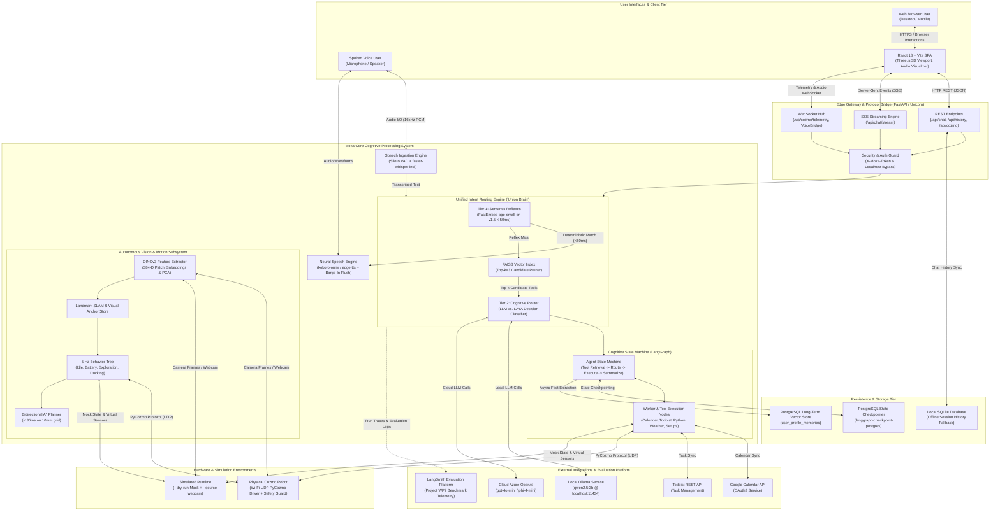

# High-Level Design (HLD): Moka AI Assistant & Tool-Routing Benchmark Suite

**Document Version:** 1.0  
**Date:** November 2026  
**Author:** Mohammad Kashefirad  
**Academic Supervisor:** Herr Christoph Vogl  
**Project Title:** Routing-Strukturen für große Tool-Mengen in einem LLM-basierten Desktop-Roboter-Assistenten: Ein Vergleich von Genauigkeit, Token-Verbrauch und Latenz  
**System Status:** Production & Evaluation Candidate  

---

## 1. Executive Summary & Document Purpose

The **Moka AI Assistant** is a local-first, multimodal cognitive system designed for dual deployment: as an interactive desktop assistant operating across speech, web, and spatial modalities, and as an empirical evaluation platform for scalable intent routing across large tool libraries ($N = 20 \dots 100$).

The purpose of this High-Level Design (HLD) document is to bridge the formal requirements defined in the [Software Requirements Specification (SRS)](file:///c:/Users/mkrad/PycharmProjects/moka_ai_assistant/srs.txt) and the underlying codebase implementation. It provides an architectural blueprint covering:
1. System context, runtime boundaries, and deployment topology.
2. Component decomposition across the multimodal bridge, intent router, cognitive state machine, dual-layer memory, and robotics vision engine.
3. End-to-end data pipelines for streaming speech, SSE token push, and episodic memory persistence.
4. The two-tier tool routing mechanisms and benchmark evaluation harness evaluating three distinct router architectures (Variants A, B, and C).
5. Cyber-physical perception and path planning running on physical hardware or gracefully degrading to simulated/webcam environments.
6. Interface contracts, security boundaries, and non-functional Service Level Objectives (SLOs).

### 1.1 Requirements Traceability Matrix (SRS Mapping)

| Requirement ID | Specification Category | Architectural Module / Implementation Target |
| :--- | :--- | :--- |
| **FR-M01** | Web UI & Gateway Bridge | FastAPI Backend (`web_api.py`), React 18 / Three.js Frontend SPA |
| **FR-M02** | Speech Input Pipeline | Silero VAD (250ms threshold, barge-in) + `faster-whisper` (int8 on CPU) |
| **FR-M03** | Speech Output & Interruption | Local neural TTS (`kokoro-onnx` / `edge-tts`) with instant speaker flush |
| **FR-M04** | Router Sandbox & Mocking | Standardized router contract dispatching to `MOCK_ACTION_DISPATCH` |
| **FR-M05** | Router A (Flat LLM Baseline) | Monolithic single-prompt baseline passing all $N$ tools to `qwen2.5:3b` |
| **FR-M06** | Router B (2-Layer LLM) | Tier 1 FastEmbed reflexes + FAISS Top-$k$ Tool RAG + `qwen2.5:3b` |
| **FR-M07** | Router C (2-Layer LAYA) | Tier 1 FastEmbed reflexes + FAISS Top-$k$ Tool RAG + `convaiinnovations/laya-typed-decisions` |
| **FR-M08** | Scaling Benchmark Harness | Automated batch runner (`compare_routers.py`) across $N \in \{20, 30, 50, 100\}$ tools |
| **FR-S01** | Short-Term Episodic Memory | LangGraph `PostgresSaver` via `psycopg` + rolling summarizer node ($> 6$ messages) |
| **FR-S02** | Long-Term Biographical Memory| Asynchronous worker (`memory_extraction_node`) + PostgreSQL vector table (`user_profile_memories`) |
| **FR-S03** | Cognitive Sub-Agents | Specialized LangGraph sub-agents (Calendar, Todoist, Python Sandbox, Weather, Search) |
| **FR-S04** | Local / Cloud Model Toggle | Dynamic runtime switch in `llm_factory.py` (Local Ollama vs. Cloud Azure OpenAI) |
| **FR-S05** | Webcam DINOv3 Perception | Vision perception fallback (`--source webcam`), 384-D patch embeddings, PCA heatmaps |
| **FR-S06** | Simulated Autonomy | Dry-run mode (`--dry-run`), 5 Hz Behavior Tree, Landmark SLAM, Bidirectional A* |
| **FR-C01** | LAYA Architecture Variants | 4-configuration benchmark matrix (1-Layer vs 2-Layer, with/without Top-$k$ pruning) |
| **FR-C02** | Benchmark Scaling Dataset | Curated 300+ query evaluation dataset with confusable pairs ($\cos \theta > 0.80$) |
| **FR-C03** | Human-In-The-Loop Confirmation | `interrupt_before` gate for state-mutating digital actions |
| **FR-C04** | Document QA (RAG) | Semantic document ingestion ETL pipeline for PDF, TXT, and Markdown files |
| **FR-C05** | Dynamic MCP Tool Ingestion | Runtime discovery and vector indexing of external Model Context Protocol tools |
| **NFR-P01** | Reflex Latency SLO | Tier 1 FastEmbed matching converges at $P_{95} < 50\,\text{ms}$ on CPU |
| **NFR-P02** | Motion Planning Latency | Bidirectional A* grid search terminates in $< 35\,\text{ms}$ on a 10mm grid |
| **NFR-P03** | Vision Perception Rate | Asynchronous DINOv3 patch extraction maintains $\ge 15\,\text{FPS}$ |
| **NFR-S01** | API Security & Authorization | Admin token validation via `X-Moka-Token` with secure localhost bypass |
| **NFR-R01** | Hardware-Free Degradation | Flawless standalone execution without physical robot connection |
| **NFR-U01** | Conversational Brevity | Spoken brevity guardrails enforce $< 2$ sentences and zero markdown formatting |

---

## 2. System Context & Ecosystem Architecture

The Moka ecosystem is structured into distinct tiers operating local-first. It decouples the client presentation layers, edge services, persistence backends, execution runtimes, and external telemetry systems.

### 2.1 Ecosystem Context Diagram (Diagram 1)

The following diagram illustrates the boundary of the Moka AI Assistant, its internal subsystems, local hardware drivers, database backends, and external third-party cloud services.

---

## 3. Technology Stack & Operating Environment

The technology stack is selected to fulfill strict local-first, privacy-preserving, and latency-bounded constraints while supporting seamless evaluation against cloud frontier models.

### 3.1 Technology Matrix

| Layer / Subsystem | Technology / Library | Version / Model | Architectural Rationale |
| :--- | :--- | :--- | :--- |
| **Web UI Framework** | React + Vite + TypeScript | React 18.3, Vite 5.x | High-performance SPA with Vertical Slice modularity and instant HMR. |
| **3D & Visualizations**| Three.js / ThreeUI | Three.js r128+ | Real-time 2D/3D visual rendering of robot trajectory, obstacle grid, and PCA heatmaps. |
| **API Gateway** | FastAPI + Uvicorn | FastAPI 0.110+, Python 3.10+ | Asynchronous event loop natively supporting ASGI, WebSockets, and SSE token streaming. |
| **Audio Processing** | Silero VAD | v4.0 / ONNX | High-precision voice activity detection (250ms threshold) with zero cloud dependency. |
| **Speech-to-Text** | `faster-whisper` | base.en / small.en (int8 CPU) | Low-latency local transcription optimized via CTranslate2 on commodity CPU hardware. |
| **Text-to-Speech** | `kokoro-onnx` / `edge-tts` | Kokoro v0.19 ONNX | Natural local neural voice synthesis with immediate thread interruption and queue flush. |
| **Tier 1 Embeddings** | FastEmbed | `BAAI/bge-small-en-v1.5` | Quantized local embeddings computing text similarities in $< 5\,\text{ms}$ on CPU. |
| **Tier 1 Routing** | Semantic Router | Custom Hash & Cosine Router | Deterministic mapping of recurring intents to instant action handlers. |
| **Tier 2 Tool RAG** | FAISS (CPU) | `faiss-cpu` 1.8+ | In-memory indexing and Euclidean/Cosine similarity retrieval for Top-$k$ tool pruning. |
| **Tier 2 Decision Engine**| LAYA Typed Decisions | `convaiinnovations/laya-typed-decisions` | Lightweight, highly constrained classification model specialized for deterministic routing. |
| **Local LLM Runtime** | Ollama | `qwen2.5:3b` (temp=0.0) | High-performance local quantized LLM for baseline routing and companion conversation. |
| **Cloud LLM Runtime** | Azure OpenAI SDK | `gpt-4o-mini` / `phi-4-mini` | Low-latency cloud fallback providing frontier-grade reasoning when toggled. |
| **Cognitive Framework** | LangGraph & LangChain | LangGraph 0.2+, LangChain Core | State machine orchestration supporting persistence, checkpointing, and conditional transitions. |
| **Short-Term Memory** | `langgraph-checkpoint-postgres` | PostgreSQL 15+ (`psycopg`) | Transactional thread-level checkpointing allowing multi-turn pause/resume capabilities. |
| **Long-Term Memory** | PostgreSQL + Array / Vector | `psycopg` + Cosine Bridge | Persistent user profiling storing extracted biographical traits across distinct sessions. |
| **Vision Perception** | DINOv3 (PyTorch / ONNX) | ViT-Small (384-D patches) | Self-supervised foundational vision backbone generating invariant patch embeddings. |
| **Motion & Planning** | Custom Python Engine | Bidirectional A* + Potential Fields | High-speed path planning ($< 35\,\text{ms}$) on a 10mm discretized 2D spatial grid. |
| **Robot Driver & Safety**| PyCozmo | PyCozmo 0.9+ with `ReflexSafetyGuard` | Low-level packet protocol over Wi-Fi UDP with hardware cliff and motor stall fail-safes. |
| **Benchmark Telemetry** | LangSmith SDK | LangSmith 0.1+ | Automated tracing, evaluation dataset versioning, latency percentile, and token tracking. |

*(Sections 4 through 9 will follow in subsequent design milestones).*

